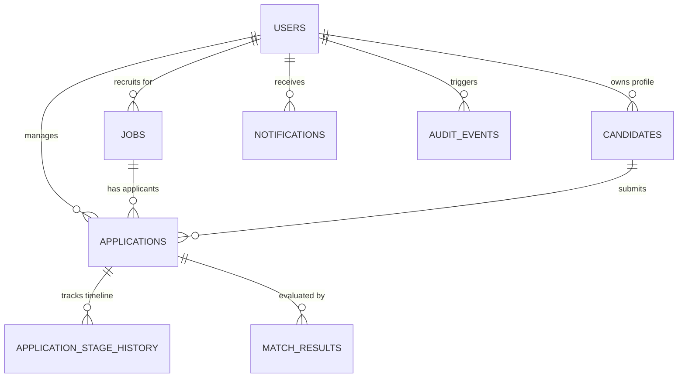

# HireFlow AI — Database Schema & Data Modeling

## 1. Entity-Relationship Overview

---

## 2. Table Specifications & Indexes

### `users`
Stores user identities, credentials, and tenant organizations.
- `id` (BIGSERIAL, PK)
- `email` (VARCHAR(255), UNIQUE, NOT NULL)
- `password_hash` (VARCHAR(255), NOT NULL) — BCrypt hash
- `full_name` (VARCHAR(150), NOT NULL)
- `role` (VARCHAR(50), NOT NULL DEFAULT 'RECRUITER') — `RECRUITER` or `ADMIN`
- `company` (VARCHAR(150))
- `created_at`, `updated_at` (TIMESTAMP WITH TIME ZONE)
- **Index**: `idx_users_email` on `(email)`

### `jobs`
Stores job openings and required skill definitions.
- `id` (BIGSERIAL, PK)
- `title` (VARCHAR(200), NOT NULL)
- `department` (VARCHAR(100), NOT NULL)
- `location` (VARCHAR(150), NOT NULL)
- `employment_type` (VARCHAR(50), NOT NULL DEFAULT 'FULL_TIME')
- `description` (TEXT, NOT NULL)
- `responsibilities` (TEXT)
- `required_skills` (TEXT, NOT NULL)
- `preferred_skills` (TEXT)
- `min_experience_years` (INT, NOT NULL DEFAULT 0)
- `status` (VARCHAR(50), NOT NULL DEFAULT 'OPEN') — `DRAFT`, `OPEN`, `CLOSED`
- `recruiter_id` (BIGINT, FK -> `users.id` ON DELETE CASCADE)
- `created_at`, `updated_at` (TIMESTAMP WITH TIME ZONE)
- **Indexes**:
  - `idx_jobs_recruiter_id` on `(recruiter_id)`
  - `idx_jobs_status` on `(status)`

### `candidates`
Stores candidate talent pool and resume text extraction results.
- `id` (BIGSERIAL, PK)
- `first_name`, `last_name` (VARCHAR(100), NOT NULL)
- `email` (VARCHAR(255), UNIQUE, NOT NULL) — Normalized lowercase email
- `phone` (VARCHAR(50))
- `location` (VARCHAR(150))
- `current_title` (VARCHAR(150))
- `years_of_experience` (INT, NOT NULL DEFAULT 0)
- `skills_summary` (TEXT)
- `resume_file_path` (VARCHAR(500)) — Filesystem location outside web root
- `resume_original_filename` (VARCHAR(255))
- `resume_text` (TEXT) — Extracted PDFBox plaintext
- `recruiter_id` (BIGINT, FK -> `users.id` ON DELETE CASCADE)
- `created_at`, `updated_at` (TIMESTAMP WITH TIME ZONE)
- **Indexes**:
  - `idx_candidates_email` on `(email)`
  - `idx_candidates_recruiter` on `(recruiter_id)`

### `applications`
Links candidates to specific job openings in a hiring pipeline.
- `id` (BIGSERIAL, PK)
- `candidate_id` (BIGINT, FK -> `candidates.id` ON DELETE CASCADE)
- `job_id` (BIGINT, FK -> `jobs.id` ON DELETE CASCADE)
- `recruiter_id` (BIGINT, FK -> `users.id` ON DELETE CASCADE)
- `stage` (VARCHAR(50), NOT NULL DEFAULT 'APPLIED')
- `interview_date` (TIMESTAMP WITH TIME ZONE)
- `notes` (TEXT)
- `created_at`, `updated_at` (TIMESTAMP WITH TIME ZONE)
- **Unique Constraint**: `uq_candidate_job` on `(candidate_id, job_id)` (prevents duplicate applications)
- **Indexes**:
  - `idx_applications_job` on `(job_id)`
  - `idx_applications_candidate` on `(candidate_id)`
  - `idx_applications_stage` on `(stage)`

### `application_stage_history`
Timestamped audit trail of all candidate stage movements.
- `id` (BIGSERIAL, PK)
- `application_id` (BIGINT, FK -> `applications.id` ON DELETE CASCADE)
- `from_stage` (VARCHAR(50))
- `to_stage` (VARCHAR(50), NOT NULL)
- `changed_by` (BIGINT, FK -> `users.id` ON DELETE SET NULL)
- `comments` (TEXT)
- `created_at` (TIMESTAMP WITH TIME ZONE)

### `match_results`
Stores AI evaluation scores, skill breakdowns, and interview suggestions.
- `id` (BIGSERIAL, PK)
- `application_id` (BIGINT, FK -> `applications.id` ON DELETE CASCADE)
- `candidate_id` (BIGINT, FK -> `candidates.id` ON DELETE CASCADE)
- `job_id` (BIGINT, FK -> `jobs.id` ON DELETE CASCADE)
- `overall_score` (INT, NOT NULL) — 0 to 100
- `skills_score` (INT, NOT NULL) — 0 to 75
- `experience_score` (INT, NOT NULL) — 0 to 25
- `matching_required_skills` (TEXT)
- `missing_required_skills` (TEXT)
- `matching_preferred_skills` (TEXT)
- `summary` (TEXT)
- `interview_questions` (TEXT)
- `provider` (VARCHAR(50), NOT NULL)
- `algorithm_version` (VARCHAR(50), NOT NULL)
- `created_at` (TIMESTAMP WITH TIME ZONE)
- **Index**: `idx_match_results_app` on `(application_id)`

### `notifications`
In-app alerts for recruiters.
- `id` (BIGSERIAL, PK)
- `user_id` (BIGINT, FK -> `users.id` ON DELETE CASCADE)
- `title` (VARCHAR(200), NOT NULL)
- `message` (TEXT, NOT NULL)
- `type` (VARCHAR(50), NOT NULL)
- `is_read` (BOOLEAN, NOT NULL DEFAULT FALSE)
- `link_url` (VARCHAR(255))
- `created_at` (TIMESTAMP WITH TIME ZONE)
- **Index**: `idx_notifications_user_read` on `(user_id, is_read)`

### `audit_events`
Security and operational compliance log.
- `id` (BIGSERIAL, PK)
- `user_id` (BIGINT, FK -> `users.id` ON DELETE SET NULL)
- `action` (VARCHAR(100), NOT NULL)
- `entity_type` (VARCHAR(100), NOT NULL)
- `entity_id` (BIGINT)
- `details` (TEXT)
- `ip_address` (VARCHAR(50))
- `created_at` (TIMESTAMP WITH TIME ZONE)
- **Index**: `idx_audit_events_created` on `(created_at DESC)`

---

## 3. Flyway Migration Versioning

Database changes are managed via Flyway migration scripts under `backend/src/main/resources/db/migration/`:
- `V1__init_schema.sql`: Initial DDL script with tables, foreign keys, unique constraints, and search indexes.
Flyway automatically creates the `flyway_schema_history` table on boot to guarantee immutable, reproducible deployments across development, staging, and production environments.
